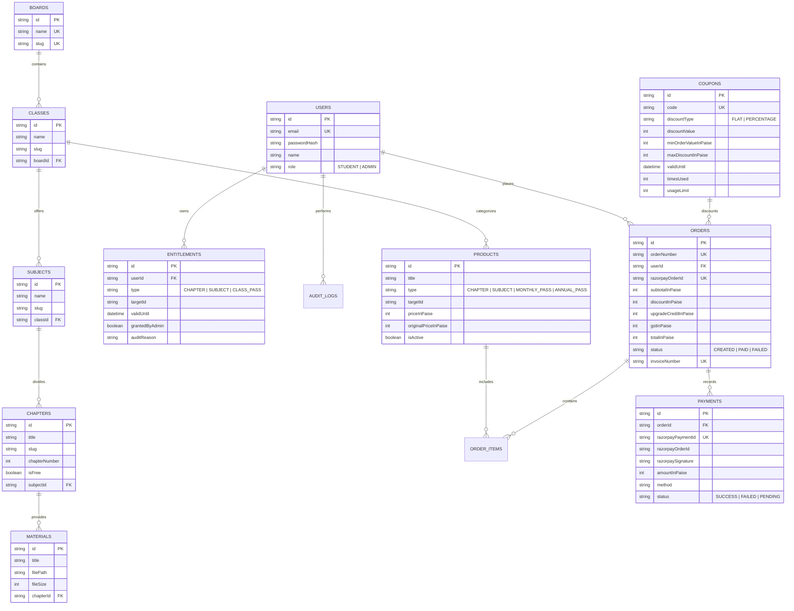

# EdTech Academy – Full-Stack Ed-Tech Web Platform

A production-grade, full-stack educational web application built for technical assessment. The platform organizes learning resources in a strict academic hierarchy (**Board → Class → Subject → Chapter → Study Materials**) and integrates **Razorpay Test Mode** payment verification, dynamic upgrade pricing, automated 18% GST tax invoicing, and in-browser protected PDF reading.

---

## 1. System Architecture & Tech Stack

### Frontend
- **Framework**: React 18 with TypeScript & Vite
- **Styling**: Tailwind CSS (Navy Blue, Indigo, and Emerald premium aesthetic)
- **Routing**: React Router DOM v7
- **HTTP Client**: Axios with JWT Bearer Interceptors & error normalization
- **Icons**: Lucide React
- **Validation & Forms**: React Hook Form with Zod

### Backend
- **Runtime**: Node.js & Express.js with TypeScript
- **Database**: PostgreSQL with Prisma ORM
- **Authentication**: JWT authentication & bcrypt password hashing
- **Payments**: Razorpay Test Mode, cryptographic HMAC-SHA256 signature verification, and raw-body webhook idempotency
- **Security**: Rate limiting, role-based access control (HTTP 403 enforcement), sanitized input validation via Zod
- **Document Engine**: PDF generation and streaming with `pdf-lib` and `multer`

---

## 2. Entity-Relationship (ER) Diagram



---

## 3. Core Business Logic Implementation

1. **Overlapping Purchases Protection**:
   - If a student owns a subject package or holds an active Class Pass, individual chapters inside that subject are automatically marked as owned and rejected from the cart with a clear notice.
2. **Dynamic Upgrade Pricing**:
   - When a student who previously purchased individual chapter notes chooses to buy the full Subject Package, **100% of the amount already paid** for those chapters is subtracted from the subject package price. The price never becomes negative (`Math.max(0, price - upgradeCredit)`).
3. **Subscriptions & Auto-Renewal**:
   - **Monthly Pass**: Grants access to all subjects and chapters in that class for 30 days.
   - **Annual Pass**: Grants access to all subjects and chapters in that class for 365 days.
   - **Renewal Extension**: If a student purchases another pass while their current pass is still active, access is extended starting from the **existing expiry date**, not from today.
4. **Free Sample Chapters**:
   - Exactly one chapter per subject is marked as a Free Sample. Students can read it immediately inside the secure PDF reader by signing in, with zero payment required.
5. **18% GST Compliance & Invoicing**:
   - All prices are stored in **integer paise** and listed inclusive of 18% GST.
   - The system calculates the itemized breakdown:
     $$\text{Taxable Base} = \text{round}\left(\frac{\text{Total Pay}}{1.18}\right)$$
     $$\text{GST Amount} = \text{Total Pay} - \text{Taxable Base} \quad (9\% \text{ CGST} + 9\% \text{ SGST})$$
   - Printable, computer-generated tax invoices are generated upon successful payment.
6. **Promotions & Coupons**:
   - Validates code, active status, expiration date, usage limits, and minimum order values with flat or capped percentage discounts.

---

## 4. Razorpay Test Mode Payment Sequence

```
Student Cart -> Backend Independent Calculation -> Create Order (CREATED)
             -> Razorpay Order ID Generated
             -> Student Opens Checkout (Cards / UPI: success@razorpay or failure@razorpay)
             -> Payment Completed on Gateway
             -> Frontend Sends paymentId, orderId, signature
             -> Backend Verifies HMAC-SHA256(orderId + "|" + paymentId, SECRET)
             -> Backend Verifies Paid Amount Matches Saved Order Amount
             -> Mark Order PAID -> Generate Tax Invoice -> Grant Entitlements
```

Webhooks for `payment.captured` and `payment.failed` verify the raw request body with `x-razorpay-signature` and ensure **idempotent execution** (duplicate events are safely detected and ignored).

---

## 5. Automated Test Suite (10/10 Passed)

The project includes Jest automated tests verifying all assessment requirements:

```bash
cd backend
npm test
```

### Verified Test Suites:
1. `Price calculation`: Accurately computes subtotal for individual products.
2. `Upgrade credit calculation`: Subtracts previously paid chapter amounts from subject packages without becoming negative.
3. `Coupon validation`: Applies percentage and flat discounts; rejects invalid or below-minimum coupons.
4. `GST calculation`: Accurately computes 18% inclusive GST, CGST (9%), SGST (9%), and taxable base in integer paise.
5. `Valid Razorpay signature`: Cryptographically verifies HMAC-SHA256 signature and grants entitlements.
6. `Tampered Razorpay signature`: Detects forged/altered signatures and logs a FAILED payment attempt.
7. `Duplicate webhook handling`: Confirms idempotency by processing first event and cleanly ignoring duplicates.
8. `Failed payment handling`: Marks order as FAILED and strictly avoids granting access.
9. `Locked PDF access`: Unauthorized requests to stream non-free materials are rejected with **HTTP 403 Forbidden**.
10. `Role-based authorization`: Student tokens attempting to query admin endpoints receive **HTTP 403 Forbidden**.

---

## 6. Installation & Execution Guide

### Prerequisites
- Node.js (v18+)
- PostgreSQL (v14+) running on `localhost:5433` (or configured via `.env`)

### Step 1: Database Setup & Seeding
```bash
# Navigate to backend
cd backend

# Install dependencies
npm install

# Generate Prisma Client & Sync Database
npx prisma generate
npx prisma db push

# Seed Sample Curriculum, Users, Products, and Coupons
npx ts-node prisma/seed.ts
```

### Step 2: Run Backend Server
```bash
# Inside backend/
npm run dev
# Server runs on http://localhost:5000 (Health Check: http://localhost:5000/api/health)
```

### Step 3: Run Frontend Application
```bash
# Navigate to frontend in a new terminal
cd frontend

# Install dependencies
npm install

# Start Vite dev server
npm run dev
# Web application available at http://localhost:5173
```

---

## 7. Default Credentials

| Role | Email | Password | Access Scope |
| :--- | :--- | :--- | :--- |
| **Student** | `student@edtech.com` | `Student@12345` | Student Dashboard, Library, Catalogue, Cart, PDF Reader, Orders |
| **Admin** | `admin@edtech.com` | `Admin@12345` | Full Admin Dashboard, Catalogue CRUD, PDF Uploader, Pricing, Entitlement Grants |

*Note: The login page includes 1-click demo buttons for instant access during evaluation.*

---

## 8. Screen Recording Demonstration Guide (< 5 mins)

When recording your demonstration for technical evaluation, follow this step-by-step walkthrough:

1. **Successful Chapter Purchase (`success@razorpay`)**:
   - Go to `http://localhost:5173/catalogue` and sign in as `student@edtech.com`.
   - Add a Chapter (e.g. *Class 10 Mathematics - Chapter 2: Polynomials*, ₹99) to the Cart.
   - Proceed to Checkout. Select the UPI tab and click **success@razorpay**.
   - Observe instant verification, redirect to **My Library**, and open the **In-Browser PDF Reader** to read the unlocked chapter.
2. **Upgrade to Subject Package**:
   - Return to Catalogue. Add *Class 10 Mathematics Complete Package* (original ₹399) to the Cart.
   - Open Cart: Observe the **Upgrade Credit of ₹99 automatically deducted** from the package price! Total payable becomes ₹300 with updated 18% GST breakdown.
3. **Failed UPI Payment (`failure@razorpay`)**:
   - In Checkout, select UPI and click **failure@razorpay**.
   - Observe the payment failure screen, error banner, and note that the student is **not granted access**. Check Order History to see the transaction logged as **FAILED**.
4. **Monthly Pass Purchase & Extension**:
   - Go to Subscriptions, select *Class 10 All-Access Monthly Pass* (₹499).
   - Complete checkout with `success@razorpay`.
   - Open **My Library** to see the 30-day countdown badge and full class-wide unlocked access.
5. **Admin Orders Dashboard**:
   - Log in as `admin@edtech.com`.
   - Navigate to `/admin` to show the revenue graph, successful vs failed payment counts, order audit table, and manual access management with audit logs.
